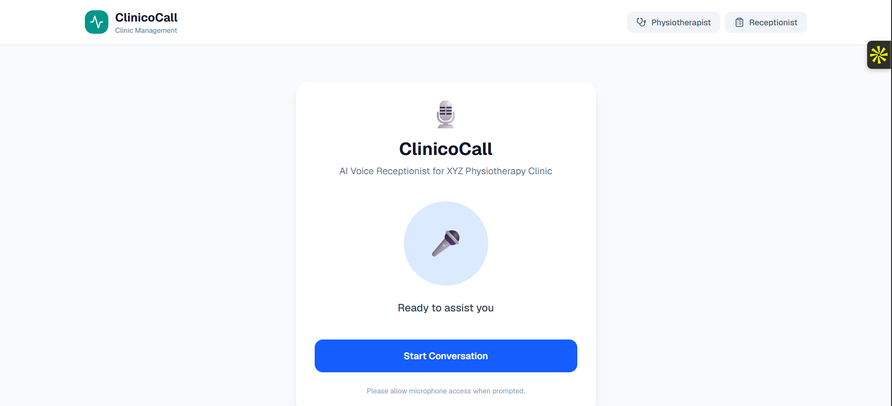
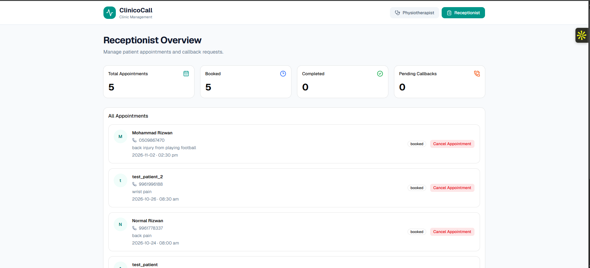
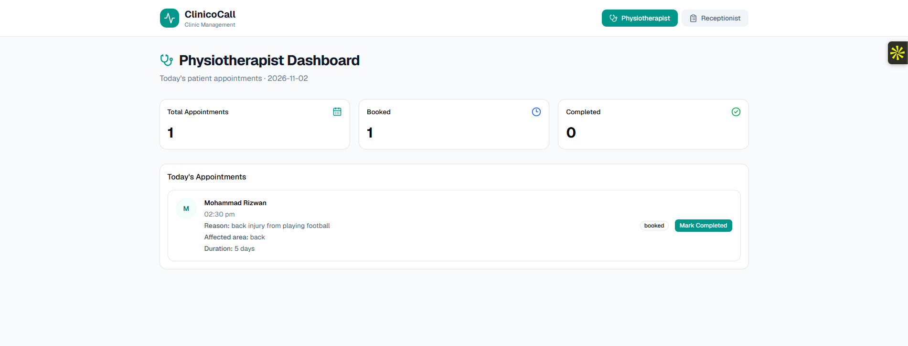
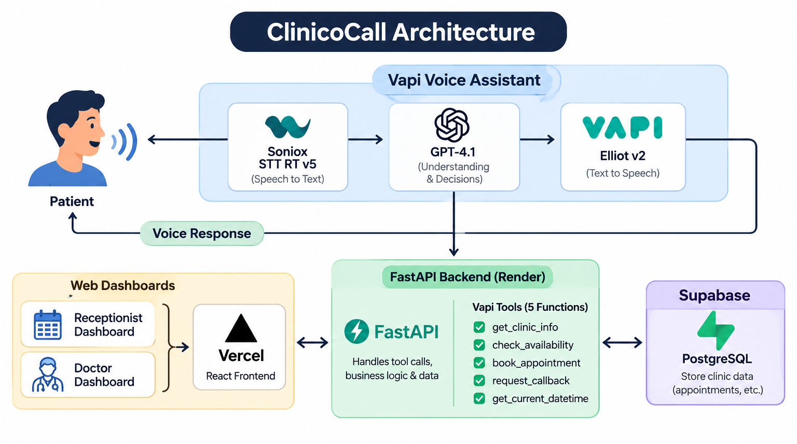

# ClinicoCall – AI Voice Receptionist for Physiotherapy Clinics

ClinicoCall is an AI-powered voice receptionist built for physiotherapy clinics. It helps clinics handle routine patient interactions, appointment bookings, and basic information collection through natural voice conversations.

The idea behind ClinicoCall is simple: doctors should spend more time treating patients and less time handling routine administrative tasks.

The voice assistant helps collect initial information from patients, such as their issue, affected area, and how long they have been experiencing it. It also allows patients to book appointments outside regular clinic hours, so clinics don't miss potential bookings when reception staff are unavailable.

By managing bookings through fixed appointment slots, ClinicoCall also helps clinics organise patient visits and reduce scheduling confusion.

## Problem and Value

ClinicoCall focuses on three common challenges faced by physiotherapy clinics.

**1. Reducing routine work for doctors**

Doctors often spend time asking patients basic questions, such as what their problem is, which area is affected, and when the issue started. The voice assistant collects this initial information before the appointment, helping reduce repetitive questioning and allowing doctors to focus more on patient care.

**2. Accepting bookings outside clinic hours**

Patients may want to book an appointment when the clinic is closed or reception staff are unavailable. ClinicoCall allows patients to interact with the assistant and request appointments through the voice interface beyond regular clinic hours, helping clinics avoid missing potential bookings.

**3. Making appointment scheduling easier**

The assistant checks fixed appointment slots before confirming a booking. This helps clinics organise their schedules, gives patients a clearer appointment time, and helps reduce unnecessary waiting and scheduling conflicts.

## Live Demo

Explore the different parts of ClinicoCall:

- **[Voice Receptionist](https://clinico-call.vercel.app/)** – Interact with the AI receptionist through voice.
- **[Receptionist Dashboard](https://clinico-call.vercel.app/receptionist)** – View and manage appointments and callback requests.
- **[Physiotherapist Dashboard](https://clinico-call.vercel.app/physiotherapist)** – View patient appointment information.

## Features

- **Voice-based interaction:** Patients can speak naturally with the AI receptionist.
- **Appointment booking:** Collects patient details and books appointments.
- **Availability checking:** Checks appointment slots before confirming a booking.
- **Clinic information:** Answers questions about clinic hours, address, and contact details.
- **Callback requests:** Records patient details and requests for a follow-up.
- **Patient Dashboard:** Provides a web interface for viewing relevant appointment information.
- **Doctor Dashboard:** Provides a separate interface for physiotherapists to view appointment information.

## Screenshots

### Voice Interface



### Receptionist Dashboard



### Physiotherapist Dashboard



## How It Works

ClinicoCall uses Vapi to manage voice conversations. The AI assistant processes what the patient says and connects to the FastAPI backend whenever it needs to perform an action.

### Voice Processing

The voice assistant uses three main components:

| Component | Technology | What it does |
|---|---|---|
| Speech-to-Text (STT) | Soniox STT RT v5 | Converts the patient's speech into text. |
| Language Model (LLM) | OpenAI GPT-4.1 | Understands the request, manages the conversation, and decides when a backend action is needed. |
| Text-to-Speech (TTS) | Vapi Elliot v2 | Converts the assistant's response into spoken audio. |

In simple terms, STT listens to the patient, the language model understands and responds, and TTS speaks the response back.

### Backend and Database

The FastAPI backend handles the actual application operations.

- **FastAPI:** Receives requests from Vapi, validates the information, executes the required logic, and communicates with the database.
- **PostgreSQL:** Stores and retrieves clinic information, appointments, and callback requests.
- **Supabase:** Hosts the PostgreSQL database used by the deployed application.

For example, when a patient wants to book an appointment:

1. The patient explains their appointment requirements through the voice interface.
2. The language model identifies that an appointment needs to be booked.
3. Vapi sends the booking tool call to the FastAPI backend.
4. FastAPI validates the details and checks the requested time slot.
5. If the slot is available, the backend saves the appointment in PostgreSQL.
6. The result is sent back to Vapi.
7. The assistant confirms the outcome to the patient through voice.

## Vapi Function Tools

To connect the voice assistant with the backend, five custom function tools are configured in Vapi.

These tools describe the actions the assistant can request and the information required for each action. The tools themselves do not perform the database operations. FastAPI receives the tool calls and executes the corresponding Python functions.

| Tool | Purpose |
|---|---|
| `get_clinic_info` | Retrieves clinic working hours, address, and contact information. |
| `check_availability` | Checks whether an appointment slot is available. |
| `book_appointment` | Validates appointment details and creates an appointment booking. |
| `request_callback` | Records patient contact details and creates a callback request. |
| `get_current_datetime` | Retrieves the current date and time for date-related requests. |

### How Tool Calls Work

1. The patient makes a request.
2. GPT-4.1 determines which tool is needed and prepares the required parameters.
3. Vapi sends the function call to the FastAPI webhook.
4. FastAPI runs the corresponding backend function.
5. The backend interacts with PostgreSQL when required.
6. FastAPI returns the result to Vapi.
7. The assistant uses the result to continue the conversation.

This keeps the voice conversation separate from the application's business logic and database operations.

## System Architecture

The diagram below will show how the voice assistant, backend, database, and dashboards communicate with each other.




## Technology Stack

| Technology | Purpose |
|---|---|
| Vapi | Manages the voice assistant and coordinates the voice pipeline and function calls. |
| Soniox STT RT v5 | Speech-to-text processing. |
| OpenAI GPT-4.1 | Understands requests and generates responses. |
| Vapi Elliot v2 | Text-to-speech processing. |
| Python | Backend programming language. |
| FastAPI | Backend API and application logic. |
| PostgreSQL | Relational database. |
| Supabase | Hosted PostgreSQL database. |
| React | Builds the web dashboards and voice interface. |
| TypeScript | Adds type safety to the frontend. |
| Vite | Frontend development and build tool. |
| Tailwind CSS | Frontend styling. |
| Vercel | Frontend hosting and deployment. |
| Render | Backend hosting and deployment. |
| Cloudflare Tunnel | Used during local development to expose the local backend to Vapi. |

## Vapi Configuration and Voice Metrics

The following values are displayed in the Vapi dashboard for the selected **Balanced** model preset.

| Component | Displayed Latency |
|---|---:|
| Soniox STT RT v5 | 410 ms |
| OpenAI GPT-4.1 | 690 ms |
| Vapi Elliot v2 | 430 ms |
| **Overall voice pipeline** | **~1,530 ms** |

Other displayed values:

| Metric | Value |
|---|---:|
| Estimated voice cost | ~$0.09/min |
| STT cost | $0.004/min |
| LLM cost | $0.02/min |
| TTS cost | $0.02/min |
| STT Word Error Rate (WER) | 1.8% |

*Note: These are indicative values shown in the Vapi dashboard for the selected configuration. They are not independent benchmarks of the complete application. Actual latency and cost may vary depending on usage and configuration.*

## Deployment

ClinicoCall uses the following deployment setup:

| Component | Platform |
|---|---|
| Frontend | Vercel |
| Backend | Render |
| Database | Supabase PostgreSQL |
| Voice AI | Vapi |

The deployed FastAPI backend connects to the Supabase PostgreSQL database using a connection URL configured in Render's environment settings.

During local development, the backend can connect to a local PostgreSQL database. Cloudflare Tunnel was used to expose the local backend to Vapi for webhook testing. It is not required in the production deployment.

## Running Locally

### Prerequisites

- Python
- Node.js and npm
- PostgreSQL
- A configured Vapi assistant

### 1. Clone the repository

```bash
git clone https://github.com/rizwan0110/ClinicoCall.git
cd ClinicoCall
```

### 2. Set up the backend

Create a `.env` file in the project root:

```env
DATABASE_URL=your_postgresql_connection_url
```

Install the backend dependencies:

```bash
pip install -r requirements.txt
```

Start the FastAPI server:

```bash
uvicorn main:app --reload
```

The API documentation is available at:

```text
http://localhost:8000/docs
```

### 3. Set up the frontend

Open another terminal and navigate to the frontend directory:

```bash
cd clinic-dashboard
```

Install the dependencies:

```bash
npm install
```

Create a `.env.local` file in the frontend directory:

```env
VITE_VAPI_PUBLIC_KEY=your_vapi_public_key
VITE_VAPI_ASSISTANT_ID=your_vapi_assistant_id
```

Start the frontend:

```bash
npm run dev
```

Open the local URL shown in the terminal to access the application.


## Project Status

ClinicoCall has a working voice interface, Vapi integration, FastAPI backend, PostgreSQL database connection, and web dashboards.

The appointment booking and callback workflows have been tested through the voice interface and API.

## Future Improvements

- Add more automated tests for important booking and availability scenarios.
- Improve handling of failed or interrupted conversations.
- Add appointment reminders and follow-up notifications.
- Introduce more detailed clinic analytics.
- Measure application-level response time, booking success rate, and voice interaction costs.
- Real-time phone integration: Connect a dedicated clinic phone number so patients can call the AI receptionist directly, with incoming calls automatically triggering the voice assistant.
---
